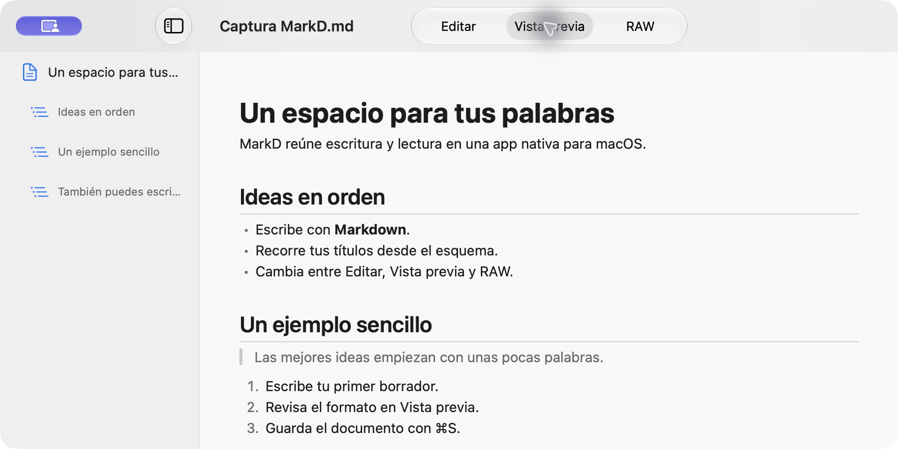
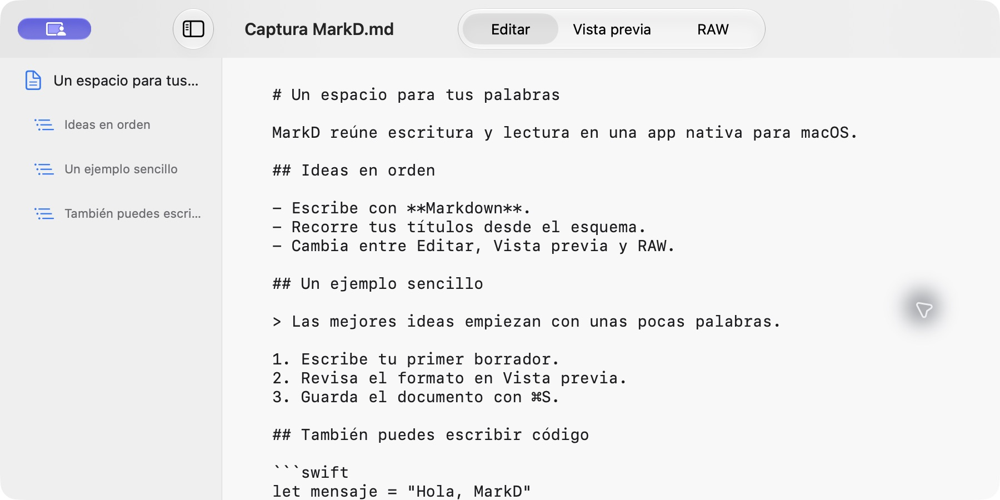

# MarkD

Un espacio para tus palabras. MarkD es un lector y editor Markdown nativo para macOS, construido con SwiftUI y AppKit.

**Estado: 0.2.0 Beta 9.** Proyecto en desarrollo; todavía no es una versión estable. Actualmente se compila desde el código y no ofrece un instalador público notarizado.



## Qué puedes hacer

- Escribir en Editar, leer con formato en Vista previa y consultar la fuente en RAW, de solo lectura.
- Recorrer los encabezados desde el esquema lateral.
- Buscar con resaltado, contador y navegación entre coincidencias.
- Usar varias ventanas y el guardado, Undo y Redo nativos de macOS.
- Elegir entre seis temas: Light, Dark, Sepia, Solarized Light, Solarized Dark y Dracula.
- Usar la app en español, inglés, catalán o japonés, o seguir el idioma del sistema.
- Crear documentos, abrir archivos y consultar la guía Markdown desde la bienvenida.



Las capturas usan un documento sintético en la Beta 9; no contienen archivos personales.

## Markdown y archivos

Abre archivos `.md`, `.markdown` y texto plano. Lee y guarda UTF-8 preservando el BOM, Unicode y saltos de línea; rechaza bytes inválidos sin repararlos silenciosamente. No convierte automáticamente otras codificaciones.

La Vista previa admite encabezados ATX y Setext, párrafos, citas, listas básicas, divisores, bloques de código y formato inline. Tablas, imágenes, listas de tareas y notas al pie todavía no están implementadas; no se declara compatibilidad completa con CommonMark o GFM.

El editor y la Vista previa usan componentes nativos, sin WebView ni servicios de red.

## Requisitos

- macOS 26.4 o posterior como mínimo declarado por el proyecto.
- Xcode 27 con SDK macOS 27 para compilar la beta actual.

La QA reciente se ejecutó en macOS 27.2, con Xcode 27.0 y Apple Silicon. **La ejecución en macOS 26.4 sigue pendiente**: el mínimo declarado no equivale a una prueba de compatibilidad completada.

## Compilar y abrir

Abre `MarkD.xcodeproj` en Xcode, selecciona el esquema MarkD y ejecuta sobre tu Mac.

También puedes hacer doble clic en `Abrir MarkD.command` o ejecutar desde la raíz:

```bash
./Abrir\ MarkD.command
```

La primera ejecución compila y abre la app. Si MarkD ya está abierta, el iniciador la lleva al frente para conservar los documentos abiertos.

Para recompilar desde la entrada de desarrollo:

```bash
./script/build_and_run.sh
```

Esta entrada solicita el cierre normal de MarkD antes de recompilar y cancela la operación si la app sigue esperando que guardes un documento.

## Atajos

| Acción | Atajo |
| --- | --- |
| Editar / Vista previa / RAW | ⌘1 / ⌘2 / ⌘3 |
| Buscar | ⌘F |
| Siguiente / anterior coincidencia | ⌘G / ⇧⌘G |
| Guardar | ⌘S |

## Límites de la beta

- **Una edición puede perderse si la app termina antes de completar un guardado o autosave.** Para persistir un cambio importante, usa ⌘S y comprueba que termine. La recuperación posterior al autosave pasó las pruebas; no se garantiza recuperar cada pulsación.
- Una escritura externa directa puede dejar visible el texto anterior hasta resolver el conflicto nativo al guardar.
- La Beta 9 mejora Vista previa con libros sintéticos grandes. Faltan archivos reales de uso, bloques individuales enormes y una revisión completa de memoria.
- Siguen pendientes VoiceOver hablado, Reducir movimiento con la preferencia del sistema activa y la matriz completa de temas, tamaños, idiomas e instalación.

Resultados y límites de las comprobaciones: [Validación](docs/VALIDATION.md). Próximas etapas: [guía del proyecto](PROJECT_GUIDE.md).

## Pruebas

```bash
./script/test_all.sh
```

Ejecuta las once suites y conserva resultados por suite. Para añadir la comprobación de metadatos de un bundle:

```bash
./script/test_all.sh /ruta/a/MarkD.app
```

Los benchmarks y recorridos UI se ejecutan por separado; no forman parte del total automático.

## Empaquetado local

```bash
./script/package_dmg.sh
```

Genera un DMG en `dist/`, valida la app y rechaza sobrescribir un archivo existente. Si ya existe el DMG, admite otra ruta de salida libre como primer argumento.

Estos paquetes tienen firma local para pruebas; no son una distribución pública notarizada. Compilaciones y DMG se excluyen de Git.

## Colaborar

Antes de cambiar el proyecto, lee [PROJECT_GUIDE.md](PROJECT_GUIDE.md) y las [instrucciones para agentes](AGENTS.md).

Al reportar un error, incluye la versión de MarkD y macOS, los pasos para reproducirlo y el resultado esperado. Usa un ejemplo mínimo sin documentos privados ni credenciales.

## Licencia y autor

Licencia [MIT](LICENSE). Autor: **Andrés Vargas**, [JAndresVC](https://github.com/JAndresVC).
